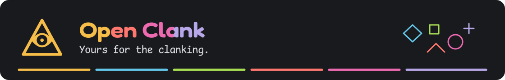
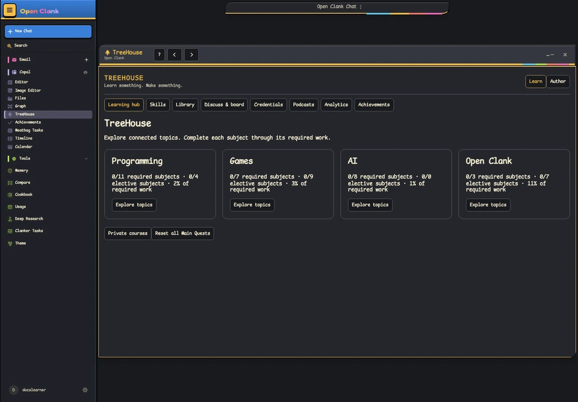

# Open Clank · Beta 1



A self-hosted workspace for models, agents, files and knowledge.

| Work | Where |
| --- | --- |
| Talk to models and use agent tools | Chat, Add Models, MiMo Code |
| Create, edit and link material | Files, Editor, Wiki, Graph |
| Plan and follow work | Tasks, calendar, email, reminders |
| Learn and practice | TreeHouse: Programming, Games, AI and Open Clank |
| Inspect and customize | History, Usage, Settings, themes and applet layouts |

Editor and Wiki share documents, drafts and Undo. **Save** or Command/Control+S
persists changes. Closing dirty work offers Save, Discard or Cancel. Local draft
recovery is not a save. Files owns managed resources and image/Imps work.

TreeHouse has four shared **Main Quests**: Programming, Games, AI and Open Clank.
General concepts and product practice have separate homes, with linked topics
and independent subject resume. Read freely; required work collects responses
or actual outcome evidence. Self-report is labeled separately from reviewed or
verified work. Responses, drafts and failed attempts stay available;
prerequisites gate only confirmed practical success. Private courses, sharing
and click-through Tutorials remain available. Read the maintained **TreeHouse**
article through **Settings → Help**.



## Start

**macOS 15+, Apple Silicon:** use `Open-Clank-1.0.2-macos-arm64.dmg` when offered
by the [application release](https://github.com/Plaer1/open-clank/releases/tag/v1.0.2-beta.1).
Check its checksum and source/target provenance. Drag **OpenClank.app** to
Applications, [install the verified offline artwork](docs/setup.md#macos-app-package)
with its packaged CLI, then open the app. Private Python, Engine and native
helpers are included. The pyramid-and-eye menu offers **Open** and **Quit**;
there is no Dock icon. The Beta app is ad-hoc signed, not notarized.

Create the first administrator in browser setup, then sign in. Authentication
is required even on localhost. The normal address is `http://127.0.0.1:7777`;
use the address printed by your launcher. Keep generated setup credentials
private and change temporary passwords.

Your Open Clank account owns workspace data. Model access is separate:
**Settings → Add Models → Local, API or Subscription**, then select a model in
Chat. Provider subscriptions may not include API credits; check provider charges
and quotas before sending requests.

Source setup needs Python 3.11+, Rust/Cargo and the platform prerequisites in
[setup](docs/setup.md). On Apple Silicon, install Homebrew, ARM-native Python and
Xcode Command Line Tools. A clone/source archive omits the full offline artwork:
obtain matching part files and `emoji-assets.parts.json` from the
[compact artwork release](https://github.com/Plaer1/open-clank/releases/tag/v1.0.2-beta.1-artwork-compact),
then run from the extracted source root:

```bash
python3 scripts/emoji_asset_bundle.py assemble --parts /path/to/emoji-parts
python3 scripts/emoji_asset_bundle.py verify
./start-macos.sh
```

First source setup downloads dependencies and builds native workers. Follow
[complete source/artwork instructions](docs/setup.md#offline-emoji-artwork) and
[upgrade preflight](docs/upgrading.md) for existing data.

## Support and limits

- Beta 1 is the first of several betas; machine version is `1.0.2`. Include the
  installed revision when reporting problems.
- macOS Apple Silicon package/source workflows have bounded qualification;
  Intel/universal builds are not claimed. Windows **source** workflows are
  tested; ARM64/x64 frozen packages still need release qualification. Use only
  artifacts/architectures actually offered by a published release.
- Linux release support remains unqualified. Docker is unsupported legacy material.
- Models, tools and integrations depend on configuration and permissions.
  Browser learning assets and JavaScript provide practice, not trusted grading
  or arbitrary host-language execution. See [known limits](docs/known-limits.md).
- Agents use the server account's OS permissions. Use an appropriately restricted
  OS account or VM, protect credentials/backups, and read [security](SECURITY.md).
- The inherited Odysseus document editor is no longer an improvement target;
  Editor/Wiki own future authoring. Existing document and email compatibility
  paths remain.

## Documentation and contributions

**Settings → Help → Wiki documentation** or **Copal handbook** opens the same
maintained read-only handbook in Wiki or Editor. Create personal documents for
practice.

[Setup](docs/setup.md) · [Upgrading](docs/upgrading.md) ·
[Backup & restore](docs/backup-restore.md) · [Beta notes](docs/beta1.md) ·
[Contributing](CONTRIBUTING.md) · [Security CI](docs/security-ci.md)

## Credits and license

Built on [Odysseus](https://github.com/odysseus-dev/odysseus), with Copal,
[MiMo Code](https://github.com/XiaomiMiMo/mimo-code)/[opencode](https://github.com/anomalyco/opencode)
and [Epic Games’ Lore](https://github.com/EpicGames/lore).
[AgentsView](https://github.com/kenn-io/agentsview) inspired interface work;
Google Noto Emoji and Emoji Kitchen supply artwork, with Xavier Salazar's Kitchen
catalogue. [Acknowledgments](ACKNOWLEDGMENTS.md) contains component notices and
provenance. **AGPL-3.0-or-later**; see [LICENSE](LICENSE). Included components retain
their own licenses.
