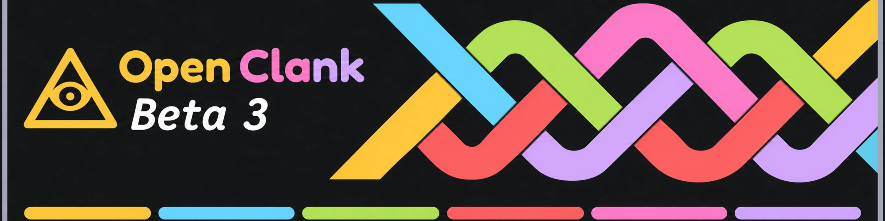
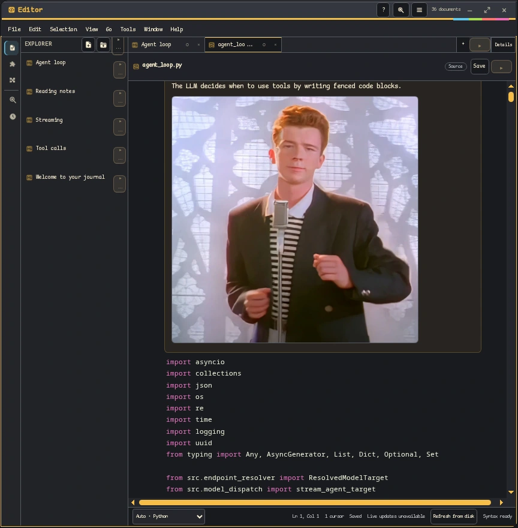
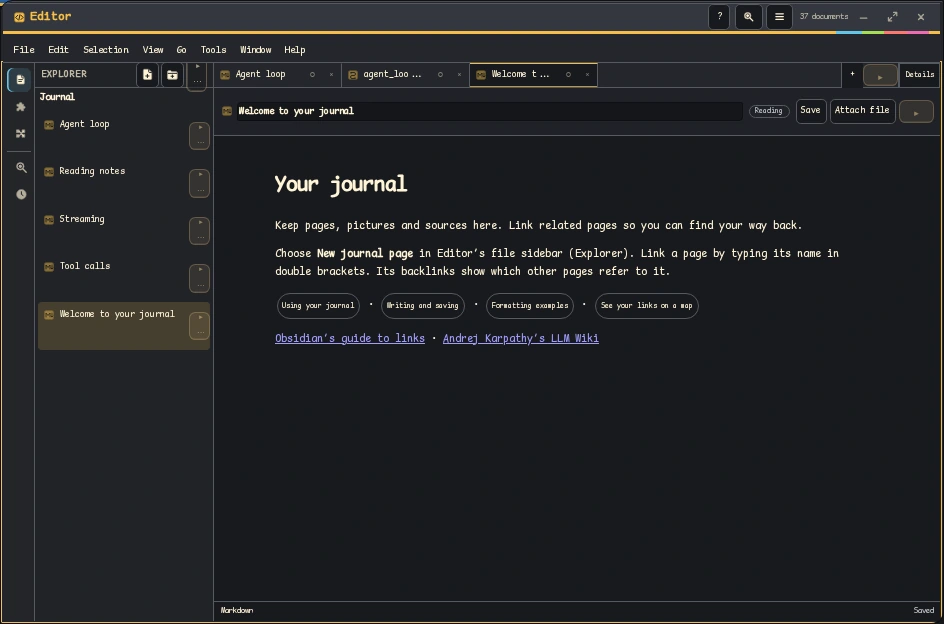
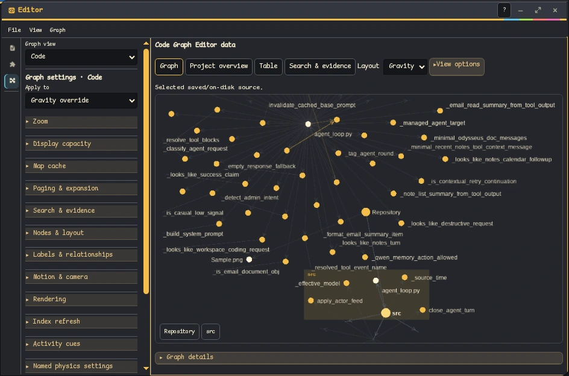
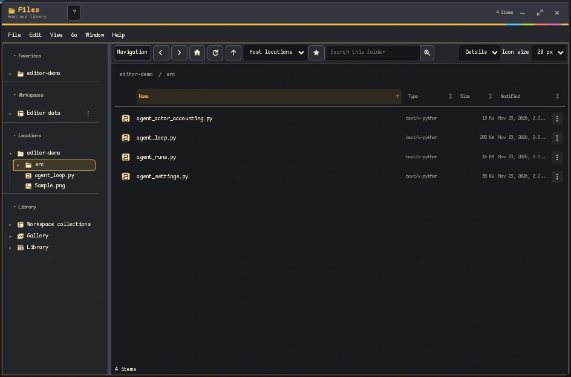
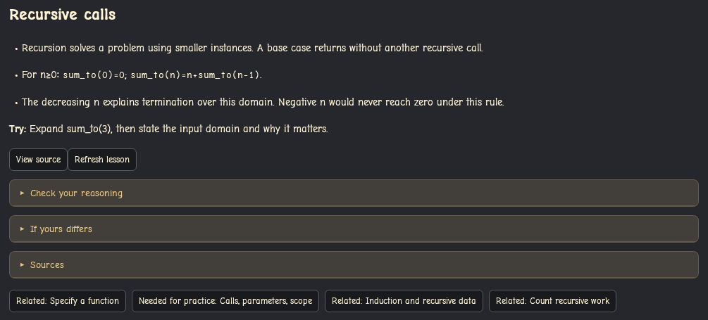
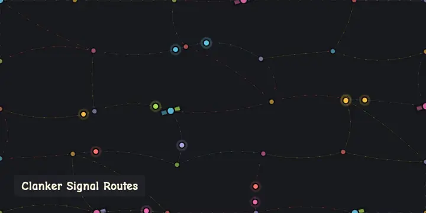
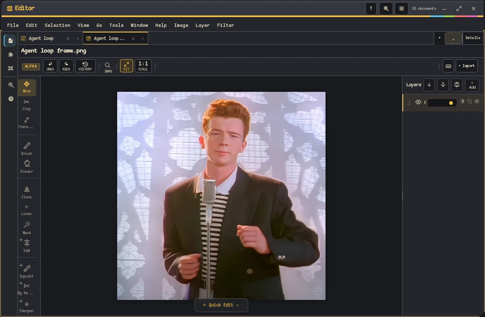

# Open Clank · Beta 3

Open Clank brings an Obsidian-style journal, a code editor, and a code graph into one self-hosted workspace. Your agent can work with the same notes and source files you do.

[Get started](#get-started) · [Explore the workspace](#journal-source-and-graph) · [See the backgrounds](#make-the-workspace-yours)

## Journal, source, and graph

**Copal** is an open-source alternative to Obsidian. Connect journal pages with `[[page names]]`, follow backlinks in Wiki, and keep the source file you’re writing about open beside your notes. Editor renders Markdown and pictures inside supported code comments.

*The image is part of [agent_loop.py](clank-code/src/agent_loop.py). Open the file in Editor and its docstring renders in place.*

**Graph** gives you two ways to follow a connection. In Journal & Wiki, trace a page to related notes and referenced files. In Code, open a project folder, expand a file into symbols, and follow a call to its definition.

**Files** opens the same workspace as a directory. Here the agent loop sits alongside its settings, run tracking, and accounting modules.

## Learn, plan, and pick up where you left off

**TreeHouse**, the pre-alpha learning suite, connects lessons with hands-on practice. A lesson on recursive calls leads straight to induction and recursive data. Follow the connection now or resume it later.

- **Tasks, Calendar, and Timeline** separate your next steps from scheduled agent work. Sync your calendar and revisit project milestones.
- **Memery** brings approved facts and preferences into later chats. **History** lets you inspect a file change and restore an earlier version.
- **Model Comparison** runs one prompt across several models. Compare answers side by side or hide their identities while you choose.

## Make the workspace yours

Tile chat beside your editor. Ask **Buddy** to explain a control by pointing at it. Open **Clankshop** to watch tool activity move a factory or drive a car in Drift.

## Image tools

Image mode is in alpha. Open a file to edit its layers, paint on the canvas, or mark a region for feedback in chat.

## Get started

1. Download Beta 3 for [Windows x64](https://github.com/Plaer1/open-clank/releases/download/v1.0.3-beta.3/Open-Clank-1.0.3-windows-x64-Setup.exe) or Linux x86_64 ([AppImage](https://github.com/Plaer1/open-clank/releases/download/v1.0.3-beta.3/Open-Clank-Beta-3-Setup-x86_64.AppImage) or [manual tarball](https://github.com/Plaer1/open-clank/releases/download/v1.0.3-beta.3/Open-Clank-Beta-3-linux-x86_64.tar.gz)). The Beta 3 macOS installer is pending. See the [setup guide](clank-code/docs/setup.md).
2. Open the local address printed by the launcher and create the first administrator account. In **Settings → Provider/Model Management**, add a local model server, API provider, or supported subscription. Usage and billing depend on the provider.
3. Start a chat and choose a working folder, or open **Copal → Journal** to write your first page. **Tools → Instruction Manual** opens the illustrated guides in Editor.

Building from source? Start in [clank-code/](clank-code/) and follow the [source setup guide](clank-code/docs/setup.md).

Agents use the server account’s OS permissions. Read the [security guide](.github/SECURITY.md) before granting access to personal files.

[Upgrade](clank-code/docs/upgrading.md) · [Backup and restore](clank-code/docs/backup-restore.md) · [Known limits](clank-code/docs/known-limits.md) · [Contribute](.github/CONTRIBUTING.md)

## Credits and license

Open Clank builds on Odysseus, MiMo Code, opencode, and Lore. See the [acknowledgments](clank-code/ACKNOWLEDGMENTS.md) for contributors, artwork, and component licenses. Open Clank is [AGPL-3.0-or-later](LICENSE).
